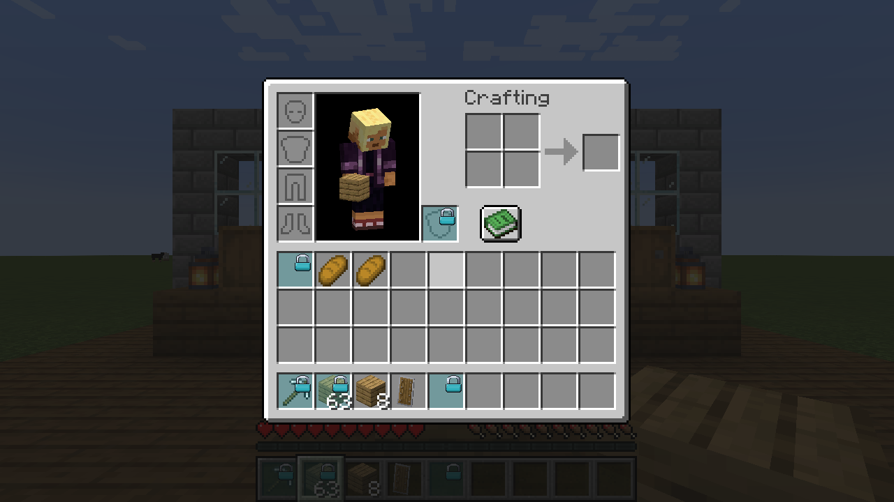

# InventoryLock

InventoryLock is a client-side Fabric mod for Minecraft Java Edition 1.21.1. Lock inventory, hotbar, and offhand slots to prevent accidental moves, swaps, and drops.

## Install

1. Set up Minecraft Java Edition **1.21.1**, **Java 21**, and **Fabric Loader 0.16.14** or later.
2. Download [InventoryLock 1.0.5](https://github.com/Likeawinnaar/InventoryLock-Beta/releases/tag/v1.0.5) and put `inventorylock-1.0.5.jar` in your profile's `mods` folder.
3. For the settings screen, add [Mod Menu 11.0.5](https://modrinth.com/mod/modmenu/version/11.0.5) with Fabric API for 1.21.1 and Placeholder API. Slot locking works with Fabric Loader and InventoryLock alone.

## Use

- Hold **Left Alt** and left-click a personal inventory, hotbar, or offhand slot to toggle its lock.
- Open **Mods → InventoryLock → Configure** to change the shortcut, drop protection, icon color, or overlay. Choose from 16 padlock colors. The display settings also apply to the hotbar during gameplay.
- **Per-Server Locks** defaults to ON. **Per-World Locks** defaults to OFF. Turn either setting off to use your shared lock set in that context. Separate locks are retained when you switch back. An update preserves previously saved choices.
- **Unlock All** clears the active lock set as soon as you confirm. Press **Done** to save other settings.

## Limits

Locks apply to supported client actions. Server updates, death and commands can still change your inventory. Quick moves can be canceled if they could reach a protected slot. Creative has additional restrictions around bulk actions, and custom inventory mods can conflict.

## More

- [Screenshots](docs/GALLERY.md)
- [Changelog](CHANGELOG.md)
- [Veelgestelde vragen (Nederlands)](docs/FAQ_NL.md)
- [Report a bug or request a feature](https://github.com/Likeawinnaar/InventoryLock-Beta/issues)

InventoryLock is in beta. See [LICENSE](LICENSE) and [NOTICE.md](NOTICE.md) for rights and credits.
